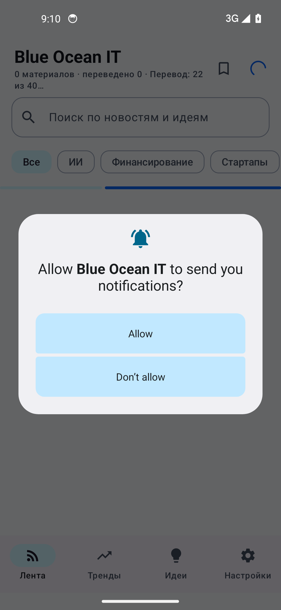
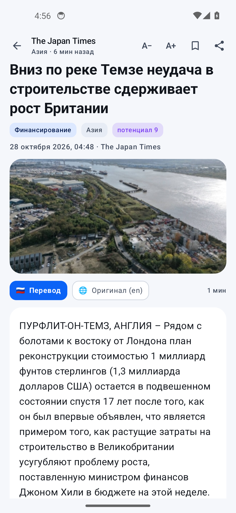
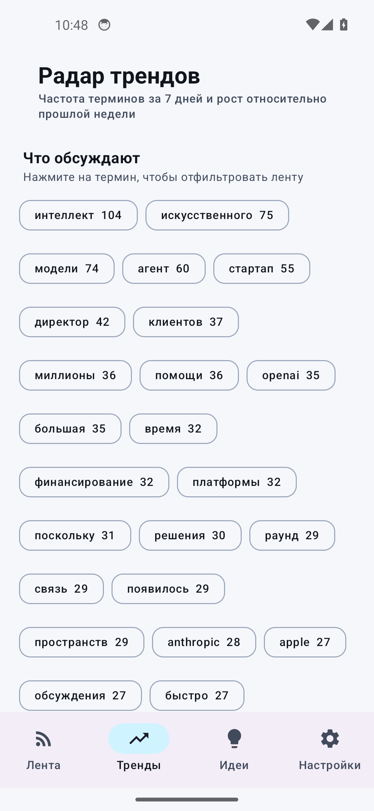
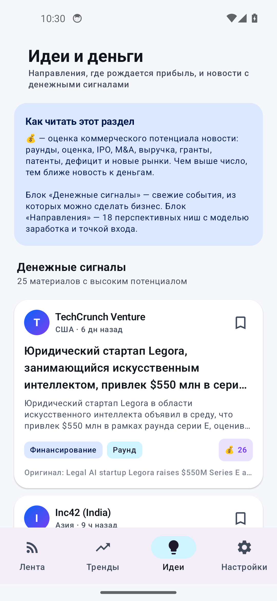
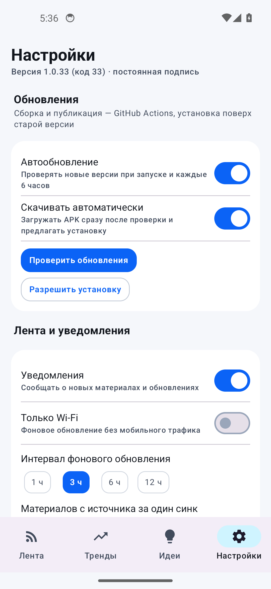
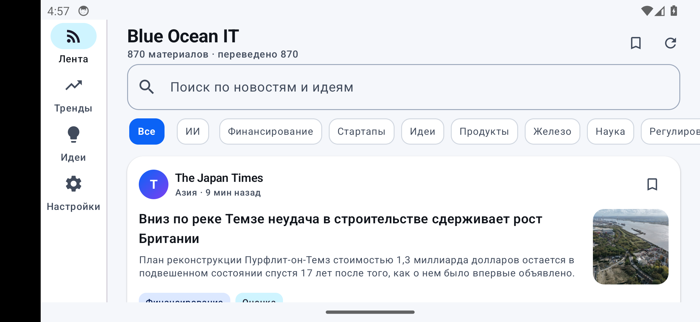
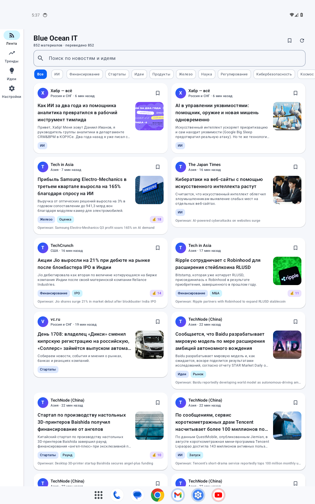

# Blue Ocean IT 🌊

<p align="center">
  
  
</p>

Android-приложение, которое собирает **все новости IT-технологий, идеи и перспективные направления
развития со всего мира**, переводит их **на русский язык** и показывает в виде **ленты сообщений**.
Отдельные разделы показывают тренды и идеи, которые могут принести прибыль.

Сборка и публикация — **GitHub Actions**. APK подписан **постоянным ключом** и обновляется
**поверх** установленной версии, с автообновлением из GitHub Releases.

---

## Что умеет

| Раздел | Возможности |
|---|---|
| **Лента** | 60+ RSS/Atom-источников из США, Европы, Азии, Африки, Ближнего Востока, России и СНГ. Автоперевод заголовков и описаний на русский, категории, поиск, избранное, pull-to-refresh |
| **Чтение статьи** | Новость открывается **внутри приложения целиком**: приложение вытаскивает полный текст со страницы источника, переводит его на русский и кэширует. Есть переключатель «Перевод / Оригинал», размер шрифта, время чтения, повтор перевода и переход на сайт |
| **Тренды** | Радар терминов за 7 дней, сравнение с прошлой неделей, рост частоты упоминаний, свежие материалы за 3 дня |
| **Идеи и деньги** | 18 перспективных направлений (ИИ-агенты, робототехника, энергетика, биотех, космос, DevTools, финтех, оборонтех и др.) с моделью заработка, точкой входа и рисками. Автоматические «денежные сигналы»: раунды, оценки, IPO, M&A, гранты, патенты, дефицит, новые рынки |
| **Настройки** | Автообновление приложения, интервал фонового синка, Wi-Fi-only, уведомления, выбор источников, прогресс перевода и кнопка «Перевести всё» |

Каждая новость оценивается по коммерческому потенциалу (💰): раунды инвестиций, оценка, IPO,
поглощения, выручка, гранты, тендеры, патенты, дефицит и новые рынки. Раздел «Идеи» сортирует
ленту по этому показателю.

---

## Перевод на русский: почему раньше переводилось не всё

Первая версия переводила за один синк только 70 самых «денежных» материалов — остальные
оставались на английском до следующего обновления, а новый синк снова занимал очередь свежими
новостями. Плюс бесплатные переводчики ограничивают частоту запросов, поэтому большая лента
не успевала перевестись за один проход.

Что изменено:

1. **Очередь перевода вместо лимита.** Сразу после загрузки новостей запускается фоновый
   перевод всего, что ещё без русского текста, — и заголовков, и описаний. Очередь идёт
   порциями по 30 материалов параллельно (3 запроса одновременно), показывает прогресс
   и продолжается при каждом запуске приложения. Проверено на эмуляторе: 871 материал,
   перевод вырос с 151 до 811 за ~2 минуты.
2. **Догоняющий воркер.** WorkManager каждые 15 минут добирает непереведённое, даже если
   приложение закрыто (в том числе материалы, на которых в прошлый раз сорвалась сеть).
3. **Частичное сохранение.** Заголовок и описание переводятся и сохраняются независимо:
   сбой на описании больше не оставляет карточку без перевода.
4. **Повтор при ошибке.** Если сервис перевода недоступен, материал не помечается переведённым —
   попытка повторится автоматически. Кнопки «Перевести» на карточке, «Перевести всё» в ленте
   и «Перевести всё» в настройках запускают перевод вручную.
5. **Скорость.** Три параллельных запроса к переводчику вместо одного: очередь из ~900 материалов
   разбирается за несколько минут вместо часа. Заголовок и описание переводятся
   раздельными запросами, поэтому текст не склеивается и не теряется, а деньги-новости
   (раунды, IPO, M&A) идут в начало очереди.
6. **Прогресс на виду.** В шапке ленты и в настройках видно «Переведено X из Y», очередь и
   индикатор — понятно, что процесс идёт, а не сломался.
7. **Кэш переводов.** Каждый перевод сохраняется в SQLite, повторно за него не платим
   запросами и не ждём.

Материалы русскоязычных источников (Хабр, vc.ru, dev.by и др.) не переводятся — они уже на русском.

### Полный текст и перевод внутри приложения

При открытии новости приложение:

1. берёт текст из `content:encoded`, если лента отдаёт полную статью;
2. иначе загружает страницу источника и вытаскивает основной текст (убирает меню, баннеры,
   подписки и прочий «мусор», собирает абзацы и заголовки);
3. переводит его на русский частями с прогрессом и кэширует результат в базе;
4. показывает перевод, а по переключателю — оригинал. Размер шрифта регулируется.

Если источник закрыт пейволом или отдаёт контент только через JavaScript, приложение честно
сообщает об этом и показывает анонс с кнопкой «Источник». Кнопка «Обновить перевод» сбрасывает
кэш и пробует заново.

### Скриншоты из автоматического smoke-теста

Каждый push собирает APK, поднимает Android-эмулятор, устанавливает приложение, открывает ленту,
первую новость и все вкладки, и складывает снимки экрана в [`docs/`](docs/):

| Лента | Чтение статьи | Тренды | Идеи |
|---|---|---|---|
|  |  |  |  |

| Настройки | Альбомная ориентация | Планшетная вёрстка |
|---|---|---|
|  |  |  |

Отчёты прогонов — `docs/smoke-result.txt`, `docs/reader-result.txt`, `docs/tabs-result.txt`.

---

## Интерфейс: единые кнопки и адаптивная вёрстка

Все интерактивные элементы собраны из одной дизайн-системы (`ui/Design.kt`), поэтому
выглядят и ведут себя одинаково на любом экране:

| Компонент | Размеры | Где используется |
|---|---|---|
| `AppButton` | Small 34 dp / Medium 44 dp / Large 52 dp, радиус 14 dp | главные и второстепенные действия, ретраи, обновления |
| `AppIconButton` | 40 × 40 dp, радиус 12 dp, иконка 20 dp | закладки, обновление ленты, назад, поделиться |
| `AppTextButton` | 40 × 40 dp | размер шрифта в читалке (А− / А+) |
| `AppChip` | 36 dp (compact 32 dp), радиус 11 dp | категории, тренды, фильтры, переключатель «Перевод / Оригинал» |
| `AppTag` | радиус 9 dp | категория, регион, денежная оценка |

Пять стилей — `Primary`, `Tonal`, `Outline`, `Ghost`, `Danger`; у всех одинаковые радиусы,
типографика, отступы и disabled-состояние (в том числе вид загрузки). Ряды кнопок
(`AppButtonRow`) собраны на `FlowRow`: на узком экране кнопки переносятся на новую строку,
а не обрезаются.

Адаптация под экраны (`ui/Responsive.kt`):

- классы окна: Compact < 600 dp, Medium 600–839 dp, Expanded ≥ 840 dp;
- поля экрана 16 / 24 / 32 dp, максимальная ширина контента 640 / 820 / 1180 dp —
  на планшете строки не растягиваются на всю ширину;
- лента на Expanded превращается в две колонки (`LazyVerticalGrid`);
- на широких экранах вкладки уходят в боковую `NavigationRail`, на телефоне остаются снизу,
  а в альбомной ориентации с низкой высотой (< 480 dp) нижняя панель скрывается;
- заголовки экранов в альбомной ориентации компактнее, у картинок в карточках три размера
  (84 / 92 / 96 dp), читалка ограничивает колонку текста и увеличивает кегль на планшете.

---

## Как установить

1. Откройте [Releases](https://github.com/zigorminsk-debug/blue-ocean-strategy/releases) —
   стабильный релиз или [dev-build](https://github.com/zigorminsk-debug/blue-ocean-strategy/releases/tag/dev-build)
   с актуальным APK `BlueOceanIT-x.y.z.apk`.
2. Скачайте APK на телефон.
3. Разрешите установку из этого источника (Android спросит сам).
4. Откройте приложение — лента появится через 20–40 секунд, перевод догоняет в фоне (виден прогресс «Переведено X из Y»).

Требования: Android 8.0+ (API 26). Интернет нужен для загрузки ленты и перевода.

---

## Автообновление

- CI публикует релиз `v1.0.N` с APK при каждом изменении в `main` (или ручном запуске workflow).
  Пока приложение не в `main`, актуальная сборка ветки лежит в prerelease
  [dev-build](https://github.com/zigorminsk-debug/blue-ocean-strategy/releases/tag/dev-build).
- Приложение раз в 6 часов и при запуске читает `/releases` и берёт **самый свежий APK
  по версии из имени файла** (`BlueOceanIT-1.0.25.apk` → `1.0.25`), а не по тегу релиза:
  рабочая ветка складывает все сборки в один релиз с тегом `dev-build`, поэтому версию
  из тега взять нельзя. Черновики игнорируются, версии сравниваются численно
  (`1.0.25 > 1.0.9`).
- Если версия новее — баннер «Доступно обновление». При включённом «Скачивать автоматически»
  APK скачивается сразу; установка — системным установщиком в один тап
  (Android требует подтверждения установки, обойти это без root/device-owner нельзя).
- Когда сеть недоступна или GitHub вернул ошибку, приложение пишет «Не удалось проверить
  обновления», а не «У вас последняя версия» — иначе сбой проверки выглядел бы как
  отсутствие обновлений.
- Перед установкой приложение сверяет **SHA-256 сертификата** скачанного APK с подписью
  установленного приложения. Подменённый или пересобранный чужим ключом APK будет отклонён.

Обновление ставится **поверх** старой версии: данные, избранное и настройки сохраняются,
потому что все сборки подписаны одним и тем же ключом и `versionCode` только растёт.

---

## Постоянный ключ подписи

| Параметр | Значение |
|---|---|
| Файл | `keystore/release.p12` (PKCS#12, RSA 3072, срок 30 лет) |
| Alias | `blueocean` |
| Пароль хранилища / ключа | `BlueOcean2026Strong!` |
| CN | `Blue Ocean IT News` |

Пароли можно переопределить секретами репозитория `KEYSTORE_PASSWORD`, `KEY_ALIAS`,
`KEY_PASSWORD` (Settings → Secrets and variables → Actions) или файлом
`keystore/keystore.properties` (в `.gitignore`).

> ⚠️ Ключ и пароль лежат в репозитории, чтобы CI мог собирать обновления без ручной настройки.
> Если планируете публиковать приложение в Google Play или сделать репозиторий приватным —
> замените ключ и храните пароли только в секретах. Потеря ключа = невозможность обновить
> приложение поверх установленного.

---

## Сборка в GitHub Actions

Workflow: [`.github/workflows/android.yml`](.github/workflows/android.yml)

- **push в любую ветку** → сборка + APK в артефактах + prerelease `dev-build` (его видит автообновление);
- **push в `main`** → сборка + опубликованный релиз (то, что видит автообновление);
- **Actions → Android APK → Run workflow** → ручной запуск с публикацией релиза.

Номер версии: `versionName = 1.0.<run_number>`, `versionCode = <run_number>`, поэтому каждая
сборка строго новее предыдущей.

---

## Локальная сборка

```bash
git clone https://github.com/zigorminsk-debug/blue-ocean-strategy.git
cd blue-ocean-strategy
./gradlew :app:assembleRelease
# APK: app/build/outputs/apk/release/app-release.apk
```

Нужны JDK 17 и Android SDK (platform 34, build-tools 34). `versionName` по умолчанию `1.0.0`;
переопределяется переменными `VERSION_NAME` / `VERSION_CODE`.

---

## Архитектура

```
app/src/main/java/by/blueocean/news/
├── MainActivity.kt            Compose-вход, разрешение на уведомления
├── BlueOceanApp.kt            каналы уведомлений, планировщик WorkManager
├── data/
│   ├── Sources.kt             60+ RSS-лент по регионам и категориям
│   ├── FeedParser.kt          RSS 2.0 / Atom / RDF на Jsoup + разбор дат
│   ├── NewsRepository.kt      параллельная загрузка, дедупликация, перевод
│   ├── Translator.kt          Google Translate (gtx) → MyMemory, кэш в SQLite
│   ├── Analyzer.kt            категории, денежные сигналы, скоринг
│   ├── Directions.kt          18 направлений с моделью заработка
│   ├── Trends.kt              радар терминов и статистика направлений
│   ├── NewsStore.kt           SQLite: статьи, избранное, кэш переводов
│   └── AppPrefs.kt            настройки
├── ui/                        Compose Material 3: Лента, Тренды, Идеи, Настройки, Читалка
│   ├── Design.kt              единые кнопки, чипы, теги
│   ├── Responsive.kt          классы окна, колонки, ширина контента
│   └── Components.kt          карточка новости, заголовок экрана, пустые состояния
├── update/UpdateManager.kt    GitHub Releases, проверка подписи, установка
├── work/Workers.kt            фоновый синк и проверка обновлений
└── util/Notifications.kt      уведомления
```

Стек: Kotlin, Jetpack Compose (Material 3), WorkManager, OkHttp, Jsoup, Coil, SQLite.
Без Firebase и платных API: перевод — публичные бесплатные эндпоинты, кэшируется локально.

---

## Ограничения и честные предупреждения

- Бесплатные переводчики (Google gtx, MyMemory) имеют лимиты по частоте запросов. Если
  сервис начал отвечать ошибкой, очередь делает паузу и продолжает позже — прогресс виден
  в ленте и настройках, вручную можно нажать «Перевести всё».
- Полный текст статьи переводится по требованию (при открытии) — так приложение не тратит
  лимиты на материалы, которые вы не читаете. Повторное открытие берёт перевод из кэша.
- Часть RSS-лент может быть недоступна из конкретной страны или временно отдавать ошибку —
  синк это переживает, остальные источники загружаются.
- Оценка «потенциала» и идеи — эвристика на ключевых словах, а не инвестиционная рекомендация.
- Приложение не является медицинской, юридической или финансовой консультацией.

Лицензия: MIT.
